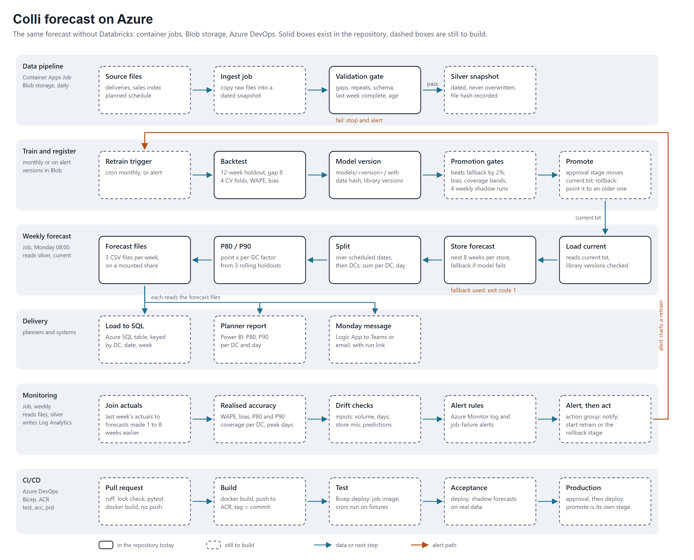

# Handover

## Framing
The assignment: forecast the delivery quantity for every store at every delivery date, 8 weeks ahead, refreshed every
week, and design how to run it in production. The business use behind it is staffing of the DCs:

| Layer | Definition | Status |
|---|---|---|
| **Business KPI** | Worker picking cost per colli | Not measured. A stand-in cost index was used in analysis only. |
| **Decision** | Workers per DC and per day | Not built. Needs colli per worker per shift, shift rules and hiring lead times. |
| **ML target** | Colli per DC per delivery date with P80 and P90 | Built: store and week, then store and date, then store, DC and date, summed per DC and date. |
| **ML metric** | Pooled, per store, DC and weekday, on peak days and holiday weeks, with pinball loss and coverage per DC | Built in the backtest. Not done: a DC by weekday table, DC-level metrics per horizon, monitoring of realised values. |

The quantile follows from the cost. If a missing colli costs *r* times a surplus colli, plan at the quantile
*r / (1 + r)*: P80 means r = 4 and P90 means r = 9. Pinball loss at that quantile equals the cost divided by (1 + r),
so the ML metric is the business KPI up to a constant. The cost ratio is not known yet, so P80 and P90 are placeholders.

Every Monday the pipeline forecasts the weekly quantity per store for the current week and the next 7 (`max_horizon = 8`),
splits each week over the planned delivery dates and DCs, and sums per DC and date. Settings:
`src/cs_outbound_coli_prediction/config.py`.

Evidence, in `experimentation/` (kept out of the repository):
- `feature_and_model_exploration.ipynb`: how the model, features, training window and parameters were chosen (4 rolling CV
  folds, then the 12-week holdout once).
- `pipeline.ipynb`: a walkthrough of the pipeline in five parts (data checks, validation set-up, modelling, metric choice,
  results), with the DC split, P80 and P90, and the backtest without a known schedule.
- `exploratory_data_analysis.ipynb` and `delivery_eda.ipynb`: the data exploration.

## Repository and checks
- GitHub repository `cs-outbound-colli-prediction`, branch `main`. This file and `experimentation/` are not committed.
- `README.md` has the setup and run steps. A fresh clone needs `data/input/store_deliveries.csv` (not in the repository) and the
  folders `data/input`, `artifacts`, `outputs`.
- Checks: `uv run ruff check src tests` and `uv run pytest` (41 tests, they need the data file). GitHub Actions
  (`.github/workflows/ci.yml`) runs `uv sync --locked`, ruff and a check that the command starts on every push to `main` and every
  pull request. It does not run the tests, because the data is not in the repository.
- Docker: the `Dockerfile` builds an image with the code and libraries only. Data, models and outputs are mounted (see the README).

## Running it
```bash
uv run cs-outbound-colli-prediction backtest                     # score chosen model and fallback on the last 12 weeks
uv run cs-outbound-colli-prediction train                        # backtest, train, save a version, promote it if it beats the fallback
uv run cs-outbound-colli-prediction make-schedule                # writes data/input/plan.csv: last week's lines repeated, to edit
uv run cs-outbound-colli-prediction forecast --schedule data/input/plan.csv   # writes outputs/<first forecast week>/
uv run pytest
```
Model versions are in `artifacts/models/<timestamp>/` (models, `backtest/by_store.csv`, `by_dc.csv`, `by_weekday.csv`, `by_day_type.csv` and `metadata.json`: git commit, data hash,
features, parameters, metrics, library versions). `artifacts/models/current.txt` names the live version;
roll back by writing an older version name into it. A version only loads with the same versions of LightGBM, XGBoost, pandas, numpy and joblib
it was trained with, so after an upgrade run `train` again.

`forecast` refuses data that ended more than 10 days ago (`--max-age-days`, for example 1000 for the fabricated data) and exits with
code 1 if any weekly forecast came from the fallback model or has no scheduled delivery date. The files are still written.

## Assumptions the code relies on
- **Run time:** Monday 08:00 with all data up to Monday 00:00. The first forecast week is the last week in the data plus one week.
- **Input checks (`validate.py`):** a problem raises an error that lists what is wrong. Delivery data: missing columns or values,
  negative quantities, repeated rows, repeated store, DC and date lines, a week without any delivery inside the history, and an
  incomplete last week (it must reach its Saturday and hold at least 40% of the usual quantity). Schedule: empty, missing store, DC or date,
  dates before the first forecast week or beyond the 8 weeks, and a store without a delivery in the last 13 weeks.
- **Horizon:** week *t* is forecast from data up to week *t - h* (h = 1 to 8), so every lag is shifted by the row's horizon.
- **Schedule:** the delivery schedule of the coming weeks is known, including the DC of each delivery, and is passed
  with `--schedule` (`store`, `dc`, `delivery_date`). It comes from whoever plans the deliveries. Without it the last week's lines are repeated
  (`make-schedule` writes the same lines to a file): a stand-in only, since in this data 39% of store-weeks change their weekday pattern.
- **Zero weeks:** a week without deliveries counts as zero from a store's first delivery onward.
- **Sundays:** the data has a single Sunday row (81 colli, one store); otherwise deliveries run Monday to Saturday.

## Models
- **Chosen:** average of LightGBM (L1) and XGBoost (Poisson), trained on all history, one model for all stores.
- **Fallback:** trailing 52-week mean (13-week mean for short history). No training needed. It is used for
  rows where the chosen model fails or returns an invalid number, and the weekly output says which one
  produced each row (`model` column).
- **Promotion rule:** a new version only becomes current if its holdout WAPE beats the fallback's. There is no margin yet, and it is not
  compared with the version that is live.

## Outputs (`outputs/<first forecast week>/`)
- `weekly_forecast.csv`: store and week, with the model used (`main` or `fallback`) and the model version.
- `daily_forecast.csv`: store, DC and delivery date. The weekly forecast is split over the scheduled dates by weekday
  shares, then over the DC lines scheduled that date by their history (weekday quantity if every DC has history on that weekday,
  else total quantity; a DC without history gets the average weight of the others).
- `dc_daily_forecast.csv`: the sum per DC and delivery date, with `quantity_p80` and `quantity_p90`. These are the point
  forecast times a factor per DC, the quantile of actual / forecast over three past holdouts (out of sample).

A second run for the same first forecast week overwrites these files.

## Results
Holdout (last 12 weeks, furthest horizon). The numbers come from `backtest`; `pipeline.ipynb` shows them with the experiment notebook's.

| Level | WAPE | Bias |
|---|---|---|
| Store and week (chosen model) | 0.113 | -0.002 |
| Store and week (fallback) | 0.125 | +0.007 |
| Store and delivery date | 0.200 | -0.005 |
| DC and delivery date, schedule known | 0.103 | -0.005 |
| DC and delivery date, schedule = last week's lines repeated (chosen model) | 0.335 | -0.006 |
| DC and delivery date, schedule = last week's lines repeated (fallback) | 0.343 | +0.007 |

The experiment notebook scores the store and week level on the same holdout at 0.114 (model) against 0.125 (best baseline), and in its four
cross-validation folds at 0.134 against 0.150. The CV folds vary from about 0.115 to 0.154, so the holdout is the easier end.

Quantiles at DC and date level (factors fitted on the two older holdouts, scored on the newest): P80 covers 77% of
DC-days and P90 covers 89%. Pinball loss at P80 0.040 against 0.053 for the point forecast, and at P90 0.025 against 0.053.
Per-horizon WAPE (store and week) barely changes between horizon 1 (0.110) and 8 (0.115).

Peak days and holiday weeks (DC and date, three holdouts, `by_day_type.csv`; the quantile factors of each holdout come from the others):

| Rows | WAPE | Bias | Fallback WAPE | Fallback bias | P80 covers | P90 covers |
|---|---|---|---|---|---|---|
| All days | 0.114 | +0.003 | 0.127 | +0.052 | 79% | 89% |
| Peak days (busiest 10% per DC, chosen by the actual) | 0.136 | -0.123 | 0.113 | -0.035 | 45% | 68% |
| Holiday weeks (Christmas week + 4) | 0.167 | -0.035 | 0.189 | +0.167 | 71% | 78% |
| Other weeks | 0.106 | +0.009 | 0.118 | +0.035 | 80% | 91% |

The holiday rows rest on two Christmases (320 DC-days). Coverage per DC varies a lot in the newest holdout (`by_dc.csv`): P80 covers from 44% (DC09) to 93% (DC03),
P90 from 76% (DC09) to 100% (DC12).

## Production design
The weekly run is designed for Azure. Solid boxes exist in the repository today, dashed boxes are still to build. The six lanes are:
data pipeline, training and registration, weekly forecast, delivery, monitoring, and CI/CD.

- **Jobs:** the container image runs as Container Apps jobs on a cron schedule, one lane per job, with a different command each (`train`, `forecast`, and so on).
  The cron runs in UTC, so the local start time moves by an hour when daylight saving changes unless it is adjusted.
- **State:** it lives in Blob storage: dated data snapshots, model version folders, the `current.txt` pointer and the forecast files. An Azure Files share is
  mounted into the job for data, models and outputs, like the `docker run -v` commands in the README, so the code needs no change.
- **Alerts:** Azure Monitor rules on failed job runs (which covers exit code 1) and on the quality metrics. The action group notifies the owner and starts the retrain
  job or the rollback stage.
- **Delivery:** a load into an Azure SQL table behind a Power BI report for planners, and a Logic App message to Teams or email.
- **CI/CD:** Azure DevOps runs ruff, the lock check, pytest and a `docker build` on a pull request. On merge it pushes the image to ACR, tagged with the commit, and
  deploys with Bicep to Test, Acceptance and Production. Test uses fixture data, Acceptance runs on real data in shadow, and Production waits for an approval.
  Promotion of a model version is its own stage with its own approver: it moves `current.txt`, and a rollback points it at an older version. CI never trains.



Monitoring and alerts, as starting values to agree with the business (checked over 4-week windows, because actuals arrive weekly):

| Signal | Threshold | Action |
|---|---|---|
| Input broken (the validation gate) | Any failure | The job fails, the last forecast stays, a failed-run alert fires |
| Fallback in use | Any (exit code 1); review above 5% of rows | Failed-run alert, check the model logs |
| Data drift | PSI above 0.2 for 2 weeks on weekly volume per store, delivery days and the share of short-history stores | Warning, retrain candidate |
| Model drift | Realised WAPE above 1.25 times the backtest, or bias beyond 5% | Alert and start a retrain |
| Range quality | P80 outside 70 to 90%, or P90 outside 82 to 96% | Refit the P80 and P90 factors only |
| Peak days | Watch only (bias -12%, P90 coverage 68% in the backtest) | Shown on the report, planners check by hand |

Promotion gates for a new version: WAPE at least 2% below the fallback and no worse than the live version on the same holdout, bias within 5%,
the coverage bands above, then 4 weekly shadow runs and a named approver.